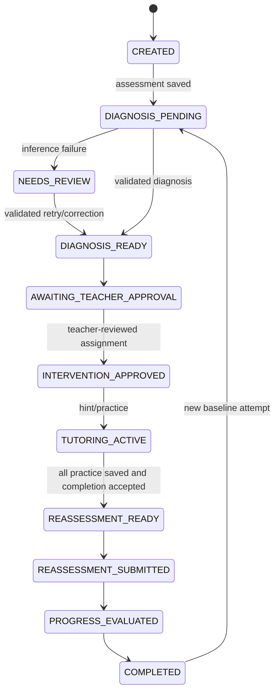

# Bounded orchestration

`learning_service.py` is the deterministic adaptive policy. It emits one typed,
allowlisted action per accepted educational event; it has no interpreter, shell,
browser, filesystem tool, arbitrary SQL generator, or model-directed dispatcher.

| Action | Effect and permission |
|---|---|
| ASK_DIAGNOSTIC_FOLLOWUP | Recommend clarification for insufficient evidence |
| OFFER_HINT | Record an authorized guided-practice hint request |
| ASSIGN_PRACTICE_RECOMMENDATION | Teacher-review recommendation only; cannot assign |
| ADJUST_DIFFICULTY | Change the stored recommended level using the evidence policy |
| RECOMMEND_LESSON | Reserved allowlisted recommendation, not currently selected by policy |
| REQUEST_TEACHER_REVIEW | Safe outcome for missing, pending or mixed evidence |
| SCHEDULE_REASSESSMENT_RECOMMENDATION | Recommendation; completion/eligibility still checked server-side |

The currently selected actions are fixed branches in `choose_action`, not strings
provided by Gemini. Approval flags are derived from those branches. Decisions are
stored separately from provider output and link to authorized evidence.

The central TRANSITIONS table additionally supports awaiting assessment, review,
and new-attempt recovery edges. Each actual transition has actor, prior/next state,
source reference and time in the ledger. Invalid edges are rejected. Optimistic
versions prevent lost session/projection writes; conflicts return 409.

Bounds: one action per evidence event; diagnosis batches at most 20 responses,
at most five workers, 45-second batch deadline by default, configured transport
timeouts; four consumed hints per assigned question and a student response before
further progression. No recursive model execution occurs. A completed reassessment
performs its finite submitted → evaluated → completed transitions.

Teacher review records exact group membership fingerprints. Credential mode rejects
review without a matching revision. Local legacy demo calls may omit that field for
compatibility; the UI sends it. Corrections invalidate pending group proposals,
while approved assignments and historical group membership remain intact. Published
lesson revision links are pinned to the version attached by the teacher.

A saved assessment survives provider failure. Validated retries process the same
pending submission. Duplicate requests cannot consume another hint level or score
a completed reassessment twice. API integration tests exercise the full finite
learning cycle. Worker queues, durable background jobs, and scheduled reconciliation
are not implemented.
