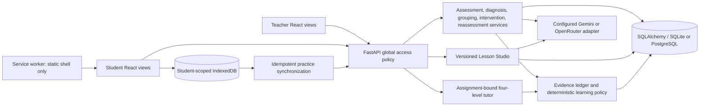

# Implemented architecture

ClassPulse AI extends the existing React/JavaScript/Vite application and FastAPI /
SQLAlchemy backend. PostgreSQL remains supported by the original schema; SQLite
is used for the executed development and acceptance checks. Migrations are manual.
The Node prototype remains archived. No general-purpose agent framework was added.



The actual local provider selected at inspection was **native Gemini**, model
`gemini-3.5-flash-lite`. Existing OpenRouter selection and its model remain intact;
this upgrade did not change the private environment. `mock` is an explicit rules
mode. Templates identify themselves as templates; inference never runs offline.
Transport metadata records the reported model when returned, and otherwise retains
the requested model. Provider bodies and credentials are not forwarded on errors.

```mermaid
sequenceDiagram
  participant S as Student
  participant A as Existing API/services
  participant G as Configured provider
  participant D as Database and evidence policy
  participant T as Teacher
  S->>A: Submit explanation and retry identity
  A->>D: Save attempt, assessment event, pending session
  T->>A: Diagnose pending class responses (bounded batch)
  A->>G: Question, answer, explanation, subject taxonomy
  G-->>A: Structured diagnosis
  A->>A: Validate taxonomy and verbatim evidence
  A->>D: Save diagnosis, learner projection, next recommendation
  T->>A: Review exact proposed group membership
  A->>D: Save teacher review
  T->>A: Generate intervention for approved group
  A->>D: Save assignment and approval-linked evidence
  T->>A: Generate/edit/review/publish lesson revision
  A->>G: Deidentified aggregate context and target misconception
  A->>D: Save immutable content revisions and reviews
  T->>A: Attach published revision to matching approved activities
  S->>A: Respond and request progressive practice hint
  A->>D: Save viewed hint and bounded next action
  S->>A: Submit all guided practice; complete activity
  A->>D: Persist completion and reassessment eligibility
  S->>A: Submit independent reassessment
  A->>D: Save scored results, evidence, learner projection and progress
```

A model proposes text or a classification. It cannot approve groups, publish
lessons, change grades or membership, execute SQL, or invoke arbitrary tools.
Assignment requires a teacher-approved group. Publication requires a reviewed
revision, explicit answer-key/language attestation, and a separate publish action.
Teacher self-review is allowed; no unsupported second-reviewer role is implied.

Existing classes have one subject/topic and students have one class membership.
The synthetic demo therefore uses three subject-specific contexts. A unified
multi-subject school roster is future work, not a silent schema reinterpretation.
See API_INVENTORY.md and DATABASE_INVENTORY.md for source-derived contracts.


## Classroom map and source-linked journey (2026-11-05)

`/teacher/map` adds a read-only teacher entry point; Overview and all prior routes
remain. The selected class owns one subject/topic. `misconception_map_service.py`
uses SQL window functions to select the latest attempt per student/question, the
latest diagnosis per submission, and the latest versioned correction. Filtering
by class/subject/topic happens before aggregation. Summary queries return counts
and timestamps without response bodies. Evidence is paginated (20 by default,
100 maximum) and joins the exact source question, original response/explanation,
AI quote/explanation, provider and correction metadata. No inference is invoked.
The visual bars and semantic concept list use the same summary records.

Counts include CORRECT and follow-up suggestions. The total is latest responses;
concept counts plus pending diagnoses reconcile to that denominator. Students can
occur in several concepts, so concept student counts must not be summed as class
membership. The minimum displayed pattern is one response, visibly marked as
limited evidence. An uncertain suggestion is M06/FOLLOW_UP or an uncorrected
suggestion with confidence below the existing 0.75 grouping threshold, persisted
needs_followup status, or no supporting quote. Confidence is uncalibrated model
output, not accuracy. A saved correction clears those original uncertainty signals
unless its effective label itself requests follow-up. Pending review means no
correction record, even for legacy status-only rows; no reviewer is invented.

Needs attention today is an all-date unresolved-work view. It imposes no midnight
cutoff and formats map/journey times in Asia/Kolkata (IST). Categories overlap.
Readiness counts distinct students with completed assignments and an absent or
pending reassessment, following the existing reassessment service rule.

Both map and Learning Evidence use `DiagnosisReview` and the existing versioned
correction endpoint. The UI previews a decision before saving, retains the command
identity through lost acknowledgements and checks current history on retry. Original
AI fields are never overwritten. Same-label confirmation is Teacher reviewed;
a changed label is Teacher corrected. Reviewer identity comes from the server's
existing auth context (self-asserted identity remains a limitation in demo mode).

The concept action routes to `/teacher/interventions?code=...#groups`. Existing
proposal generation, member inspection, approval/rejection and confirmed group-wide
support remain authoritative. Approval and support generation recheck persisted
membership against the class. Assigned work remains historical if a later
correction invalidates an unexecuted proposal.

`/student/progress` now includes paginated chronology from submissions, support
assignments, practice responses and completed reassessments. Source IDs are retained;
assignments and reassessments join through their actual foreign keys. There is no
response-to-assignment foreign key: the UI explicitly presents response history
alongside the linked support sequence rather than claiming one response caused an
assignment or score change. Missing events remain absent. Teacher-only correction
reasons and private notes are not included in student journey payloads.

All new data routes use existing session/role/class checks and explicit teacher or
owned-student checks. No tables, migrations, provider interfaces, runtime packages,
or external services were added. `/api/system-status` checks local database access
and safe provider configuration only; it never probes generation or exposes keys,
models, connection URLs or hostnames. `/teacher/guide` and `/student/guide` explain
the workflow, actual data handling and local help without sending a report.

Evaluation is a separate offline process (`scripts.heldout_evaluation`). A strict
local manifest records provenance, review metadata, source groups and split/tuning
boundaries. A frozen development-majority baseline and recorded model outputs use
the identical held-out denominator. No dataset is uploaded. Current independent
evaluation is NOT TESTED because no approved educator references were supplied.

The fresh demo (`scripts.run_map_demo`) creates a new private directory and SQLite
file, migrates it, seeds six classes of 40 learners, five Fractions assessment
questions and varied Fractions source responses through the real assessment service,
and leaves new diagnoses absent. The other classes retain their existing six sample
learners with responses and add 34 roster-only learners. The presentation student
can submit additional responses in the UI; diagnosis and subsequent steps follow
the normal local mock pipeline. Existing directories are always
refused. Starting again creates a new run and retains the previous one; there is
no destructive reset capability. The API owns its listening socket so port conflicts
cannot silently send the frontend to a different database.
