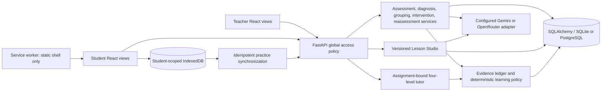

# Implemented architecture

ClassPulse AI extends the existing React/JavaScript/Vite application and FastAPI /
SQLAlchemy backend. PostgreSQL remains supported by the original schema; SQLite
is used for the executed development and acceptance checks. Migrations are manual.
The Node prototype remains archived. No general-purpose agent framework was added.



The actual local provider selected at inspection was **native Gemini**, model
`gemini-3.5-flash-lite`. Existing OpenRouter selection and its model remain intact;
this upgrade did not change the private environment. `mock` is an explicit rules
mode. Templates identify themselves as templates; inference never runs offline.
Transport metadata records the reported model when returned, and otherwise retains
the requested model. Provider bodies and credentials are not forwarded on errors.

```mermaid
sequenceDiagram
  participant S as Student
  participant A as Existing API/services
  participant G as Configured provider
  participant D as Database and evidence policy
  participant T as Teacher
  S->>A: Submit explanation and retry identity
  A->>D: Save attempt, assessment event, pending session
  T->>A: Diagnose pending class responses (bounded batch)
  A->>G: Question, answer, explanation, subject taxonomy
  G-->>A: Structured diagnosis
  A->>A: Validate taxonomy and verbatim evidence
  A->>D: Save diagnosis, learner projection, next recommendation
  T->>A: Review exact proposed group membership
  A->>D: Save teacher review
  T->>A: Generate intervention for approved group
  A->>D: Save assignment and approval-linked evidence
  T->>A: Generate/edit/review/publish lesson revision
  A->>G: Deidentified aggregate context and target misconception
  A->>D: Save immutable content revisions and reviews
  T->>A: Attach published revision to matching approved activities
  S->>A: Respond and request progressive practice hint
  A->>D: Save viewed hint and bounded next action
  S->>A: Submit all guided practice; complete activity
  A->>D: Persist completion and reassessment eligibility
  S->>A: Submit independent reassessment
  A->>D: Save scored results, evidence, learner projection and progress
```

A model proposes text or a classification. It cannot approve groups, publish
lessons, change grades or membership, execute SQL, or invoke arbitrary tools.
Assignment requires a teacher-approved group. Publication requires a reviewed
revision, explicit answer-key/language attestation, and a separate publish action.
Teacher self-review is allowed; no unsupported second-reviewer role is implied.

Existing classes have one subject/topic and students have one class membership.
The synthetic demo therefore uses three subject-specific contexts. A unified
multi-subject school roster is future work, not a silent schema reinterpretation.
See API_INVENTORY.md and DATABASE_INVENTORY.md for source-derived contracts.
