# Quiz learning loop: implementation and hackathon demo

## Purpose and demonstrated scope

ClassPulse connects teacher-authored multiple-choice quizzes to student reflection and a live teacher report. The student explains an incorrect answer before the tutor interprets it. Teachers see observed answer counts separately from tentative error themes and can flag an interpretation. A repair question checks one subsequent response; a five-minute lesson suggestion helps the teacher act on the findings.

The implementation extends OpenQuest's React/Vite frontend and FastAPI/SQLAlchemy backend. Quizzes remain separate from the existing synthetic topic-assessment, grouping, and intervention flows. The teacher copilot receives a summary of the three newest published quizzes alongside its existing baseline data.

## Run locally

From `backend/`, with the existing Python requirements installed:

```bash
python3 -m alembic upgrade head
python3 -m uvicorn app.main:app --host 127.0.0.1 --port 8011
```

This uses the existing repository `.env` and database. If the database has no demo classes, run `python3 -m scripts.import_synthetic_dataset --include-multisubject` after migrations. Do not reset an existing database.

From `frontend/`:

```bash
npm install
CLASS_PULSE_BACKEND_URL=http://127.0.0.1:8011 npm run dev
```

Use the Vite URL displayed in the terminal. Choose a class at the demo entry screen, then **Quizzes** in the navigation. For the Docker setup, rebuild the API image and apply `alembic upgrade head` in the API container before using the new screens.

`AI_PROVIDER=gemini` uses `GEMINI_API_KEY` and `GEMINI_MODEL` through the native Google API; `AI_PROVIDER=openrouter` uses the existing OpenRouter key and model configuration. `AI_PROVIDER=mock` enables explicitly labeled template feedback, which always leaves the error type uncertain. Templates can quote teacher explanations; they do not pretend to classify misconceptions. English, Hindi, and Telugu student controls and feedback prompts are supported. Teacher-authored questions and explanations retain their original language; live translation quality has not been validated.

Direct Gemini is now selected in the local configuration using `gemini-3.5-flash-lite`. Live app requests returned HTTP 200 with `provider=gemini` for both a student reflection and a teacher copilot reply. The student feedback retained an exact supporting quote from the synthetic student explanation. Native request formatting, credential-safe errors, provider selection, and both sidebar response paths also have controlled-response tests. The earlier OpenRouter account had returned HTTP 402; it is no longer the selected provider.

## Demonstration

1. In teacher access, select the Mathematics/Fractions synthetic class. Open **Quizzes → Create quiz → Load fractions example**. The example has five questions and a different, teacher-approved repair question for each.
2. Review the content and keys, save the draft, then publish. The new quiz is visible only to students of this class. Each correct answer earns one mark; submissions are final.
3. In a separate browser context or tab using student access for the same class, open **Quizzes**, take the quiz, and choose an incorrect option on question 1 or 5.
4. Select **Understand this mistake**. Explain the reasoning, receive feedback, and attempt the repair challenge. Reload to show the conversation and repair result persist.
5. Return to the already-open teacher report. Visible reports refresh every five seconds after the previous request completes. Inspect option counts, uncertain cases, supporting quotes, and repair results. Flag an interpretation to remove it from supported themes.
6. Generate a next-lesson suggestion. Review its source submission/reflection counts, edit it, and accept or reject it. It is never automatically delivered to students. The stored suggestion is a snapshot, and the UI indicates when more submissions have arrived.

## Data and workflow

```mermaid
flowchart LR
    Teacher[Teacher editor / CSV review] --> Quiz[Draft then fixed published quiz]
    Quiz --> Student[Student submission]
    Student --> Grade[Deterministic answer-key grading]
    Grade --> Reason[Student explains a missed answer]
    Reason --> Tutor[Bounded tutor + evidence validation]
    Tutor --> Repair[Teacher-approved repair challenge]
    Tutor --> Report[Observed counts + tentative themes]
    Repair --> Report
    Report --> Review[Teacher review / five-minute lesson]
```



`quizzes` stores the title, class, status, question snapshots, and optional lesson snapshot. `quiz_attempts` stores one immutable answer map and score per student/quiz. `quiz_reflections` stores a bounded conversation, latest interpretation and evidence, teacher flag, and optional repair answer per attempt/question. New Alembic revision `0006_quiz_learning_loop` adds these three tables without changing existing assessment records; the generated PostgreSQL SQL export includes the new revision.

Published question snapshots cannot be edited. A duplicate submission returns the original result rather than overwriting a score. Correct answers, teacher explanations, and repair keys are omitted from the student quiz before submission. Repair keys are omitted until the student has answered the repair question. A missing, extra, duplicated, or invalid original answer is rejected atomically.

The learner record is deliberately limited to observed answers, student reasoning, tentative error categories, and one repair observation per missed question. It is not a psychological profile, a permanent ability label, or a validated mastery score.

## API contracts

Teacher quiz routes require `X-Demo-Role: teacher` and `X-Class-ID`; student routes require a matching `X-Student-ID` and class membership. These are self-asserted **demo scope checks, not authentication**.

| Routes (under `/api`) | Purpose |
| --- | --- |
| `GET/POST /classes/{class_id}/quizzes` | List quizzes or create a draft |
| `GET/PATCH /quizzes/{quiz_id}` | Review or replace an unpublished draft |
| `POST /quizzes/{quiz_id}/publish` | Publish an immutable question snapshot |
| `POST /quizzes/import` | Validate CSV text and return editable preview questions or row errors |
| `GET /quizzes/{quiz_id}/insights` | Observed counts, tentative themes, supporting evidence, repair outcomes, saved lesson |
| `PATCH /quizzes/{quiz_id}/reflections/{reflection_id}/review` | Flag or restore an interpretation |
| `POST/PATCH /quizzes/{quiz_id}/lesson` | Generate a saved draft, or edit/review it |
| `GET /students/{student_id}/quizzes` | List published quizzes for this student’s class |
| `GET /students/{student_id}/quizzes/{quiz_id}` | Quiz questions and the student’s saved result |
| `POST /students/{student_id}/quizzes/{quiz_id}/submit` | Submit exactly one option per question |
| `POST /students/{student_id}/quizzes/{quiz_id}/questions/{question_id}/reflect` | Send reasoning or a follow-up message |
| `POST /students/{student_id}/quizzes/{quiz_id}/questions/{question_id}/repair` | Grade one repair answer using the teacher key |

Question option indexes in JSON are zero-based. A quiz has 1–20 questions and each question has 2–4 distinct options, one correct option, and a teacher explanation. The initial UI editor and CSV template use four options. Optional repair questions include their own options, correct answer, explanation, and hint. Quiz creation uses JSON `{title, questions}`. CSV preview uses `{content}`; reflection uses `{message, language}`. The application rejects unknown question authoring fields and excessive input lengths.

## CSV

Download the template from the quiz editor. Required headers: `question,option_a,option_b,option_c,option_d,correct_option,explanation`. Correct options are letters A–D. `concept` is optional. Optional repair columns appear in the template; when `repair_question` is nonempty, complete all repair columns. Blank repair fields leave the challenge disabled for that question.

The file picker accepts `.csv` files up to 200 KB. Server preview is limited to 200,000 characters and 20 questions; it handles UTF-8 BOM, quoted commas, and line breaks. Invalid rows return errors without saving a partial quiz. Saving or publishing always requires teacher action. PDF, Word, and image extraction are outside this version.

## AI, safety, and operational boundaries

- Grading and correct answers come exclusively from the teacher’s stored key. The model has no grading or database-write tools.
- The student tutor receives only that question, its teacher explanation, selected option, requested language, and this student’s bounded conversation. Class identity, other students, and repair keys are excluded.
- Live feedback uses validated JSON with `concept`, `procedure`, `misread`, or `uncertain`. Supporting evidence must be an exact nonempty quote from a student message; invalid evidence forces uncertainty. Explicit guessing or uncertainty phrases in the supported languages also force uncertainty. This check is conservative and cannot establish that a quoted statement semantically proves the proposed error type.
- The tutor can exchange up to five student/tutor message pairs per missed question. Failures do not save a fabricated reply or change the submitted grade; the student can retry with the entered explanation.
- The teacher report derives counts from saved attempts. Uncertain and flagged interpretations do not count as supported themes. The raw count of wrong choices does not establish why they were chosen.
- Lesson generation sends aggregate question evidence and teacher explanations, without student identifiers or conversation quotes. If live generation fails, an explicitly labeled template suggestion and generation note are saved. Accepted lessons remain teacher-reviewed drafts for classroom use, rather than autonomous assignments.
- Imported content, student messages, and model replies are rendered as text. User content is treated as data in prompts. This reduces exposure but does not prove immunity to prompt injection or educational hallucinations.
- API keys stay in the backend environment. Use synthetic learners and avoid personal information in messages. Production authentication, authorization, retention/deletion controls, moderation review, provider data policies, distributed rate limiting, and concurrency hardening need a separate deployment milestone.
- Existing offline assets do not provide offline AI tutoring. Polling reduces implementation complexity for a classroom demo but is not a large-scale event-streaming architecture.

## Verification and evaluation

Backend tests cover authoring/publishing, hidden answer keys, input rejection, class/student scope, repeat submissions, saved conversations, repair grading, uncertain guesses, quote validation, malformed AI replies, provider outages, bounded conversations, teacher flags, lesson review, and copilot quiz grounding. Migration tests apply every revision to a fresh SQLite database and run Alembic’s metadata-drift check.

Browser tests use a disposable database and mock provider, leaving the configured application database untouched. They exercise the full authoring-to-report flow, live polling, reload persistence, a 390px layout, Hindi controls, malformed CSV, and a failed AI request followed by retry. Run from `frontend` after installing Python backend dependencies:

```bash
npx playwright install chromium
npm run test:e2e
npm run build
npm run lint
npm run i18n:check
```

Run `python3 -m pytest -q` from `backend`. The PostgreSQL integration test is conditional on a separate disposable test-database URL. Browser test traces and screenshots are written to ignored `frontend/test-results`.

Use observed functionality and failure handling as evaluation evidence. The existing offline taxonomy-label evaluator applies to legacy diagnoses; it does not evaluate the new conversation-based error categories. No numeric diagnosis-accuracy or learning-gain claim is justified yet. Before a classroom pilot, have educators label held-out conversations and check error-category agreement, uncertain-case rate, explanation correctness, language quality, feedback latency, and provider cost. Report the sample size and whether learners are synthetic or real. Do not claim mastery or causal learning gains from a single repair question.

Verification on 2026-11-02: **137 backend tests passed**, **1 optional PostgreSQL integration test skipped** (no disposable PostgreSQL test URL supplied), and **4 browser acceptance tests passed**. Production frontend build, frontend lint, new-Python unused-name checks, translation-key checks (275 keys for each language), schema-drift check, and `git diff --check` passed. The frontend dependency audit reported zero vulnerabilities. Backend tests emitted the installed Starlette/httpx deprecation warning; the browser outage test intentionally logged the simulated HTTP 503. These results establish tested prototype behavior, not educational effectiveness or production readiness.
